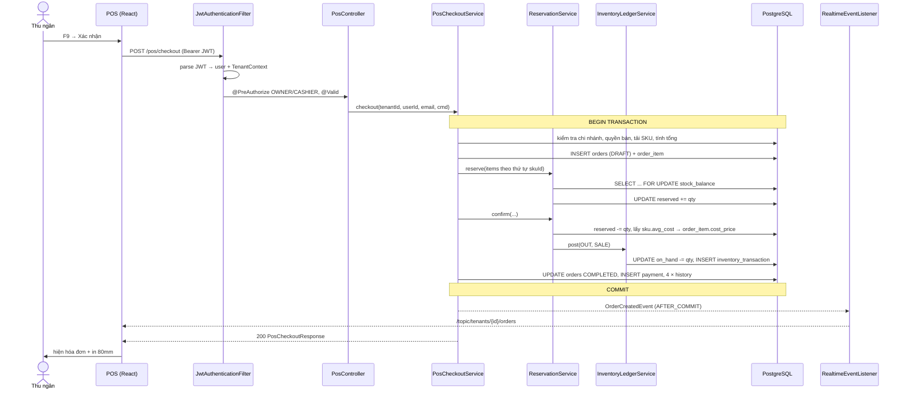

# Giải thích toàn bộ dự án OISM – tài liệu ôn vấn đáp

> Viết cho người **mới biết code sơ sơ**. Đọc từ trên xuống: phần 1–4 là nền tảng, phần 5–7 là "backend chạy thế nào", **phần 8 là luồng đặt hàng (trọng tâm)**, phần 9–14 là các cơ chế đặc biệt, phần 17 là **bộ câu hỏi vấn đáp có sẵn câu trả lời**.
>
> Mỗi khi nhắc tới một hàm, tài liệu ghi kèm **tên file** để bạn mở ra xem khi thầy hỏi "chỉ cho thầy đoạn code đó".

---

## Mục lục

1. [Dự án này làm gì? (nói trong 30 giây)](#1-dự-án-này-làm-gì-nói-trong-30-giây)
2. [Bức tranh tổng thể: 4 khối của hệ thống](#2-bức-tranh-tổng-thể-4-khối-của-hệ-thống)
3. [Công nghệ dùng và tác dụng của từng cái](#3-công-nghệ-dùng-và-tác-dụng-của-từng-cái)
4. [Từ điển khái niệm cho người mới](#4-từ-điển-khái-niệm-cho-người-mới)
5. [Kiến trúc backend: 4 lớp (Clean Architecture)](#5-kiến-trúc-backend-4-lớp-clean-architecture)
6. [Backend "mapping" ra sao? (6 loại ánh xạ)](#6-backend-mapping-ra-sao-6-loại-ánh-xạ)
7. [Pipeline: một request đi qua những đâu](#7-pipeline-một-request-đi-qua-những-đâu)
8. [⭐ LUỒNG ĐẶT HÀNG – hàm nào chạy, làm gì](#8--luồng-đặt-hàng--hàm-nào-chạy-làm-gì)
9. [Chống bán vượt tồn kho (Flash Sale)](#9-chống-bán-vượt-tồn-kho-flash-sale)
10. [Sổ cái tồn kho và giá vốn bình quân](#10-sổ-cái-tồn-kho-và-giá-vốn-bình-quân)
11. [Đăng nhập, JWT, refresh token, phân quyền](#11-đăng-nhập-jwt-refresh-token-phân-quyền)
12. [Nhiều cửa hàng dùng chung (multi-tenant)](#12-nhiều-cửa-hàng-dùng-chung-multi-tenant)
13. [Realtime: WebSocket STOMP + cảnh báo tồn thấp](#13-realtime-websocket-stomp--cảnh-báo-tồn-thấp)
14. [Tác vụ nền, báo cáo, nhập/chuyển/kiểm kho](#14-tác-vụ-nền-báo-cáo-nhậpchuyểnkiểm-kho)
15. [Frontend: Admin và POS gọi API thế nào](#15-frontend-admin-và-pos-gọi-api-thế-nào)
16. [Cơ sở dữ liệu, kiểm thử, Docker, CI/CD](#16-cơ-sở-dữ-liệu-kiểm-thử-docker-cicd)
17. [Bộ câu hỏi vấn đáp + trả lời mẫu](#17-bộ-câu-hỏi-vấn-đáp--trả-lời-mẫu)
18. [Hạn chế nên biết trước (để không bị bất ngờ)](#18-hạn-chế-nên-biết-trước-để-không-bị-bất-ngờ)
19. [Phụ lục: danh sách API và bảng mã lỗi](#19-phụ-lục-danh-sách-api-và-bảng-mã-lỗi)

---

## 1. Dự án này làm gì? (nói trong 30 giây)

**OISM = Omnichannel Inventory and Sales Management** – hệ thống quản lý **bán hàng và tồn kho đa kênh**.

Hình dung một shop quần áo có 2 chi nhánh, vừa bán tại quầy, vừa bán trên Shopee và TikTok Shop. Vấn đề của họ:

- Đơn đến từ **nhiều nơi** (quầy, nhân viên nhập tay, Shopee, TikTok) → muốn gom về **một chỗ**.
- Chỉ còn 1 cái áo mà 2 khách cùng đặt một lúc → **không được bán 2 lần** (chống bán vượt).
- Muốn biết **lãi thật** → phải biết **giá vốn** của từng món lúc bán.
- Muốn **lịch sử kho không bị sửa lén** → mọi thay đổi tồn kho ghi vào **sổ cái chỉ ghi thêm**.

OISM chạy theo mô hình **SaaS nhiều cửa hàng (multi-tenant)**: nhiều shop cùng dùng một hệ thống, dữ liệu mỗi shop tách biệt.

**3 vai trò người dùng:**

| Vai trò | Được làm gì |
| --- | --- |
| **OWNER** (chủ shop) | Toàn quyền |
| **STAFF** (nhân viên kho) | Kho, đơn hàng, xem báo cáo tồn |
| **CASHIER** (thu ngân) | Chỉ bán hàng ở POS, tra sản phẩm, chỉ tại chi nhánh được gán |

---

## 2. Bức tranh tổng thể: 4 khối của hệ thống

```
 ┌────────────────────┐      ┌────────────────────┐      ┌──────────────────┐
 │ Admin Dashboard    │      │ POS (máy bán hàng) │      │ Sàn Shopee/TikTok │
 │ React + Ant Design │      │ React, PWA         │      │ (giả lập webhook) │
 │ cổng 3000 / 5173   │      │ cổng 3001          │      │                   │
 └─────────┬──────────┘      └─────────┬──────────┘      └────────┬─────────┘
           │ HTTP/JSON + JWT           │ HTTP/JSON + JWT          │ HTTP/JSON + X-Api-Key
           │ WebSocket (thông báo)     │ WebSocket                │
           ▼                           ▼                          ▼
 ┌──────────────────────────────────────────────────────────────────────────┐
 │              BACKEND  Spring Boot 3.3 (Java 17) – cổng 8080              │
 │   /api/v1/...  (REST)        /ws (WebSocket STOMP)     Swagger UI        │
 └──────────────────────────────────┬───────────────────────────────────────┘
                                    │ JDBC (SQL)
                                    ▼
                    ┌───────────────────────────────┐
                    │ PostgreSQL 16 – cổng 5432     │
                    │ DB oism_db, bảng do Flyway tạo │
                    └───────────────────────────────┘
```

- **Frontend** (2 app React) chỉ lo **hiển thị** và **gửi yêu cầu**. Không có logic nghiệp vụ quan trọng (frontend có kiểm tra sơ bộ, nhưng backend luôn kiểm tra lại).
- **Backend** là "bộ não": kiểm tra quyền, kiểm tra tồn kho, tính tiền, ghi sổ.
- **PostgreSQL** là "kho lưu trữ": lưu mọi dữ liệu, và còn là **lớp bảo vệ cuối** (ràng buộc CHECK, UNIQUE, trigger).
- Tất cả chạy bằng **Docker Compose** (file `docker-compose.yml`): 1 lệnh `docker compose up -d --build` là lên hết.

Ba "đường" giao tiếp:

| Đường | Dùng cho | Xác thực bằng |
| --- | --- | --- |
| **REST** `http://localhost:8080/api/v1/...` | Mọi thao tác (đăng nhập, tạo đơn, xem báo cáo…) | Header `Authorization: Bearer <JWT>` |
| **Webhook** `POST /api/v1/webhooks/shopee` | Sàn gửi đơn mới sang | Header `X-Api-Key: oism_...` |
| **WebSocket** `ws://localhost:8080/ws` | Server **đẩy** thông báo "có đơn mới", "sắp hết hàng" | JWT gửi lúc CONNECT |

---

## 3. Công nghệ dùng và tác dụng của từng cái

### 3.1 Backend

| Công nghệ | Là gì (nói dễ hiểu) | Dùng trong dự án để làm gì |
| --- | --- | --- |
| **Java 17** | Ngôn ngữ lập trình | Viết toàn bộ backend. Dùng `record` (lớp dữ liệu gọn) cho DTO, `switch ->` |
| **Spring Boot 3.3** | Bộ khung (framework) giúp dựng web server nhanh, tự cấu hình | Khởi động server ở `BackendApplication.java`, tự quét và tạo các đối tượng `@Service`, `@RestController`… |
| **Spring Web (MVC)** | Phần của Spring nhận HTTP request và gọi đúng hàm | `@RestController`, `@GetMapping`, `@PostMapping` – ánh xạ URL → hàm Java |
| **Spring Security** | Bộ bảo vệ: ai được vào, ai bị chặn | Kiểm tra JWT, API key webhook, phân quyền `@PreAuthorize("hasRole('OWNER')")` |
| **JJWT** (thư viện io.jsonwebtoken) | Tạo và kiểm tra JWT | `JwtService.issue()` ký token, `JwtService.parse()` đọc token |
| **BCrypt** | Thuật toán băm mật khẩu một chiều, có "muối" | Không lưu mật khẩu thật, chỉ lưu bản băm (`passwordEncoder.encode`) |
| **Spring Data JPA + Hibernate** | **ORM**: làm việc với bảng SQL qua đối tượng Java | `SalesOrder` ↔ bảng `orders`; viết interface `findByIdAndTenantId` là tự có câu SQL |
| **PostgreSQL 16** | Hệ quản trị CSDL quan hệ | Lưu dữ liệu, khóa dòng `FOR UPDATE`, trigger chặn sửa sổ cái |
| **Flyway** | Công cụ quản lý phiên bản CSDL (migration) | File `V1__...sql` → `V13__...sql` chạy lần lượt khi backend khởi động để tạo/sửa bảng |
| **Bean Validation** (`jakarta.validation`) | Kiểm tra dữ liệu đầu vào bằng chú thích | `@NotNull`, `@Min(1)`, `@Pattern` trên request; sai → 400 |
| **Spring AOP** | "Chen" code chạy trước/sau một nhóm hàm mà không sửa hàm đó | `TenantFilterAspect` tự bật bộ lọc tenant trước **mọi** lần gọi repository |
| **Spring WebSocket + STOMP** | Kênh 2 chiều luôn mở giữa trình duyệt và server | Đẩy thông báo đơn mới / cảnh báo tồn thấp tức thì |
| **@Scheduled** (Spring Scheduling) | Hẹn giờ chạy hàm tự động | Mỗi phút hủy đơn giữ hàng quá hạn; 2h sáng chốt báo cáo ngày |
| **Spring Events** | Cơ chế "phát sự kiện – lắng nghe" trong app | Phát `OrderCreatedEvent`, chỉ gửi WebSocket **sau khi commit** |
| **springdoc-openapi** | Tự sinh tài liệu API + trang thử API | Swagger UI ở `http://localhost:8080/swagger-ui.html` |
| **Spring Actuator** | Điểm kiểm tra "server còn sống không" | `/actuator/health` cho Docker healthcheck |
| **Maven** (`pom.xml`, `mvnw`) | Công cụ build, tải thư viện | `./mvnw clean verify` build + chạy test |

### 3.2 Frontend

| Công nghệ | Dùng để làm gì |
| --- | --- |
| **React 19** | Thư viện dựng giao diện theo "component" (mỗi phần màn hình là 1 hàm) |
| **TypeScript** | JavaScript có kiểu dữ liệu → bắt lỗi sớm (ví dụ `CheckoutPayload` phải đúng field) |
| **Vite** | Công cụ chạy dev server nhanh và đóng gói (build) ra file tĩnh |
| **Axios** | Thư viện gửi HTTP request; dùng **interceptor** để tự gắn token và tự làm mới token |
| **Ant Design (antd)** | Bộ component giao diện có sẵn (bảng, form, modal) – chỉ ở Admin |
| **React Router** | Điều hướng trang trong Admin (`/orders`, `/products`…) |
| **@stomp/stompjs** | Client WebSocket STOMP để nhận thông báo realtime |
| **Recharts** | Vẽ biểu đồ ở Dashboard/báo cáo |
| **jsbarcode / qrcode** | Vẽ mã vạch EAN-13 (Admin in tem), vẽ mã QR thanh toán (POS) |
| **PWA (Service Worker `sw.js`)** | POS cài được như app, mở được giao diện khi mất mạng |
| **Nginx** | Web server phục vụ file đã build của 2 frontend khi chạy Docker |

### 3.3 Kiểm thử và triển khai

| Công nghệ | Dùng để làm gì |
| --- | --- |
| **JUnit 5 + Mockito** | Unit test: test từng hàm, giả lập (mock) phụ thuộc |
| **Testcontainers** | Integration test: tự bật một PostgreSQL thật trong Docker để test |
| **ArchUnit** | Test **kiến trúc**: đảm bảo controller không gọi thẳng repository, domain không phụ thuộc lớp ngoài |
| **JaCoCo** | Đo độ phủ test (coverage), cổng tối thiểu 80% ở module quan trọng |
| **Vitest** | Unit test cho POS (`cart.test.ts`) |
| **Postman/newman, Playwright** | Test API tự động, test giao diện E2E |
| **Docker, docker-compose** | Đóng gói mỗi phần vào container, chạy cả hệ thống 1 lệnh |
| **GitHub Actions** (`.github/workflows/ci.yml`) | CI: mỗi lần đẩy code tự build + test backend, lint + build frontend |

---

## 4. Từ điển khái niệm cho người mới

| Thuật ngữ | Giải thích đời thường | Trong dự án |
| --- | --- | --- |
| **HTTP request/response** | Trình duyệt "gửi thư" (request) tới server, server "trả thư" (response) | `POST /api/v1/pos/checkout` → trả hóa đơn |
| **REST API** | Quy ước đặt URL theo "tài nguyên" + động từ HTTP | `GET /orders` = xem danh sách, `POST /orders` = tạo mới |
| **JSON** | Định dạng dữ liệu dạng `{"key": value}` | Mọi request/response đều là JSON |
| **HTTP status** | Mã kết quả: 200 OK, 201 Created, 400 dữ liệu sai, 401 chưa đăng nhập, 403 không đủ quyền, 404 không thấy, 409 xung đột, 500 lỗi server | `409 IV40901` = hết hàng |
| **DTO** | Đối tượng chỉ để chở dữ liệu vào/ra API | `CreateOrderRequest`, `OrderView` |
| **Entity** | Lớp Java tương ứng một bảng | `SalesOrder` ↔ `orders` |
| **Repository** | Lớp chuyên đọc/ghi một bảng | `SalesOrderRepository` |
| **Service** | Nơi chứa **quy tắc nghiệp vụ** | `OrderService`, `PosCheckoutService` |
| **Transaction (giao dịch)** | Một nhóm thao tác **hoặc thành công hết, hoặc hủy hết** (rollback) | `@Transactional` trên hàm checkout |
| **Lock (khóa dòng)** | "Giữ chỗ" một dòng trong bảng, người khác phải **đợi** | `SELECT ... FOR UPDATE` trên `stock_balance` |
| **Deadlock** | 2 người giữ khóa của nhau và chờ nhau mãi | Tránh bằng cách luôn khóa theo thứ tự `skuId` tăng dần |
| **JWT** | "Vé" có chữ ký số, ghi sẵn bạn là ai, thuộc shop nào, vai trò gì | Access token sống 60 phút |
| **Refresh token** | "Vé dài hạn" dùng để xin vé JWT mới | Sống 7 ngày, mỗi lần dùng đổi vé mới (xoay vòng) |
| **Tenant** | Một cửa hàng khách hàng của hệ thống | Cột `tenant_id` trên mọi bảng |
| **Migration** | File SQL nâng cấp cấu trúc CSDL theo phiên bản | `db/migration/V4__ord_orders.sql` |
| **Webhook** | Hệ thống A **tự gọi** vào URL của hệ thống B khi có sự kiện | Shopee gọi `POST /webhooks/shopee` khi có đơn |
| **WebSocket** | Đường dây mở liên tục, server chủ động gửi tin | Thông báo đơn mới hiện ngay ở Admin/POS |
| **SKU** | Mã một **biến thể** cụ thể (áo Polo **size M**) | Tồn kho, giá bán tính theo SKU |
| **Dependency Injection** | Spring tự "đưa" các đối tượng cần dùng vào constructor | `OrderService(SalesOrderRepository ..., ReservationService ...)` |

---

## 5. Kiến trúc backend: 4 lớp (Clean Architecture)

Code nằm trong `backend/src/main/java/com/oism/`, chia **theo lớp trước, theo module sau**:

```
com.oism
├── web/             (1) LỚP GIAO TIẾP: nhận HTTP, kiểm tra dữ liệu vào, gọi application
│                        OrderController, PosController, WebhookController, GlobalExceptionHandler…
├── application/     (2) LỚP NGHIỆP VỤ (use case): @Service + @Transactional
│                        OrderService, PosCheckoutService, ReservationService, InventoryLedgerService…
├── domain/          (3) LÕI: entity, interface repository, quy tắc thuần, mã lỗi, sự kiện
│                        SalesOrder, StockBalance, OrderStateMachine, CostCalculator, ErrorCode…
└── infrastructure/  (4) KỸ THUẬT: bảo mật JWT, tenant, WebSocket, lịch chạy nền, seed dữ liệu
                         SecurityConfig, JwtService, TenantFilterAspect, RealtimeEventListener…
```

**Quy tắc phụ thuộc** (ai được "biết" ai):

| Lớp | Được phụ thuộc vào |
| --- | --- |
| `web` | `application` (KHÔNG gọi thẳng repository) |
| `application` | `domain` |
| `infrastructure` | `domain`, `application` |
| `domain` | không ai cả |

**Vì sao chia như vậy?**
- Lõi nghiệp vụ (`domain`) không dính tới web hay CSDL → dễ test, dễ thay công nghệ.
- Controller "mỏng": chỉ nhận – kiểm tra – chuyển tiếp. Logic nằm ở service, dùng lại được cho nhiều kênh (ví dụ `OrderService.createAndReserve` được dùng bởi **cả** Webhook **và** Simulator).
- Quy tắc này **được kiểm tra tự động** bằng `ArchitectureTest.java` (ArchUnit) trong CI – ai viết sai là test đỏ.

> **Câu hay bị hỏi:** "Đây có phải MVC không?" → Có. **Model** = entity/service, **Controller** = `@RestController`, **View** = hai ứng dụng React (backend chỉ trả JSON, không render HTML). Bên trong backend tổ chức theo Clean Architecture 4 lớp.

---

## 6. Backend "mapping" ra sao? (6 loại ánh xạ)

"Mapping" trong backend có 6 nghĩa, thầy có thể hỏi bất kỳ nghĩa nào:

### 6.1 URL → hàm Java (Request Mapping)

```java
@RestController
@RequestMapping("/api/v1/orders")                 // tiền tố chung
@PreAuthorize("hasAnyRole('OWNER','STAFF')")     // cả lớp chỉ Owner/Staff
public class OrderController {

    @PostMapping                                  // POST /api/v1/orders
    public ResponseEntity<OrderView> create(...)

    @PostMapping("/{id}/confirm")                 // POST /api/v1/orders/abc-123/confirm
    public OrderView confirm(@PathVariable UUID id, ...)

    @GetMapping                                   // GET /api/v1/orders?status=RESERVED&page=0
    public PageResult<OrderView> list(@RequestParam(required=false) OrderStatus status, ...)
}
```

- `@PathVariable` lấy giá trị **trong đường dẫn** (`{id}`).
- `@RequestParam` lấy giá trị **sau dấu `?`**.
- `@RequestBody` lấy **thân JSON**.
- `@AuthenticationPrincipal AuthenticatedUser user` lấy **người đang đăng nhập** (do bộ lọc JWT đặt vào) → có `user.tenantId()`, `user.userId()`, `user.role()`.

Ai làm việc "tìm đúng hàm"? → **DispatcherServlet** của Spring MVC.

### 6.2 JSON → đối tượng Java (Jackson)

Trình duyệt gửi:
```json
{ "branchId": "a0...01", "items": [{"skuId": "b0...02", "quantity": 2}], "paymentMethod": "CASH", "cashReceived": 500000 }
```
Spring dùng thư viện **Jackson** tự chuyển thành record Java:
```java
public record PosCheckoutRequest(@NotNull UUID branchId, @NotEmpty List<PosItemRequest> items,
                                 @NotNull PaymentMethod paymentMethod, BigDecimal cashReceived, ...) {}
```
Tên field JSON **phải trùng** tên field record. Chiều ngược lại, record `OrderView` trả về được Jackson đổi thành JSON.

### 6.3 Kiểm tra dữ liệu (Validation)

`@Valid @RequestBody` → Spring kiểm tra các chú thích `@NotNull`, `@Min(1)`, `@Size`, `@Pattern`. Sai → `GlobalExceptionHandler.handleMethodArgumentNotValid` trả **400** kèm danh sách field sai:
```json
{"errorCode": "OD40001", "message": "Dữ liệu không hợp lệ", "details": [{"field": "items[0].quantity", "message": "Số lượng phải lớn hơn 0"}]}
```

### 6.4 Đối tượng Java ↔ bảng CSDL (ORM – JPA/Hibernate)

```java
@Entity(name = "SalesOrder")
@Table(name = "orders")                       // lớp SalesOrder ↔ bảng orders
public class SalesOrder extends TenantScopedEntity {
    @Column(name = "branch_id") private UUID branchId;          // field ↔ cột
    @Enumerated(EnumType.STRING)
    @Column(name = "status") private OrderStatus status;        // enum lưu dạng chữ 'RESERVED'
    @Column(name = "total_amount") private BigDecimal totalAmount;
    @Column(name = "reserved_until") private Instant reservedUntil;
}
```
- Cột chung `id` (UUID), `created_at`, `updated_at` nằm ở `BaseEntity` (`@MappedSuperclass`), tự gán bằng `@PrePersist` / `@PreUpdate`.
- Cột `tenant_id` nằm ở `TenantScopedEntity`.
- Tiền dùng `BigDecimal` (không dùng `double` vì `double` làm tròn sai với tiền).
- Bảng tên `orders` chứ không phải `order` vì `ORDER` là từ khóa SQL.
- `ddl-auto: validate`: Hibernate **không** tự tạo bảng, chỉ kiểm tra entity khớp bảng; bảng do **Flyway** tạo.

**Lưu ý thiết kế:** dự án **không dùng** `@OneToMany/@ManyToOne`. Liên kết giữa bảng lưu bằng **ID** (`orderId`, `skuId`) và truy vấn riêng. Lý do: đơn giản, tránh lỗi tải dữ liệu ngầm (lazy loading, N+1 khó kiểm soát), dễ kiểm soát tenant.

### 6.5 Tên hàm → câu SQL (Spring Data derived query)

Chỉ cần khai báo **interface**, Spring tự viết SQL theo tên hàm:

| Hàm trong `SalesOrderRepository` | SQL Spring tự sinh (tương đương) |
| --- | --- |
| `findByIdAndTenantId(id, tenantId)` | `SELECT * FROM orders WHERE id=? AND tenant_id=?` |
| `existsByTenantIdAndCode(t, code)` | `SELECT 1 FROM orders WHERE tenant_id=? AND code=? LIMIT 1` |
| `findByTenantIdAndStatusAndReservedUntilBefore(t, RESERVED, now)` | `... WHERE tenant_id=? AND status='RESERVED' AND reserved_until < ?` |

Khi cần SQL đặc biệt thì viết tay bằng `@Query`, ví dụ khóa dòng:
```java
@Lock(LockModeType.PESSIMISTIC_WRITE)     // → SELECT ... FOR UPDATE
@Query("select b from StockBalance b where b.tenantId=:tenantId and b.branchId=:branchId and b.skuId=:skuId")
Optional<StockBalance> findForUpdate(...);
```
Lọc động (danh sách đơn theo nhiều điều kiện tùy chọn) dùng **Specification** (`OrderService.list`).

### 6.6 Exception → HTTP status + JSON lỗi

Service ném `new BusinessException(ErrorCode.IV40901, "Không đủ hàng...")` → `GlobalExceptionHandler` (`@RestControllerAdvice`) bắt và trả:
```
HTTP 409
{"errorCode": "IV40901", "message": "Không đủ hàng khả dụng cho SKU POLO-M (còn 1, yêu cầu 2)", "details": []}
```
Mã lỗi có cấu trúc `<MODULE><HTTP><SỐ>`: `IV` (kho) + `409` + `01`. HTTP status lấy từ enum `ErrorCode`.

---

## 7. Pipeline: một request đi qua những đâu

Lấy ví dụ thu ngân bấm **F9 – Thanh toán** ở POS. Request đi qua **15 trạm**:

```
[Trình duyệt POS]
 1. SaleScreen.handleCheckout()            (frontend-pos/src/SaleScreen.tsx)
 2. api.posCheckout(payload)               (frontend-pos/src/api.ts)
 3. Axios request interceptor              → gắn header "Authorization: Bearer <accessToken>"
        │  HTTP POST http://localhost:8080/api/v1/pos/checkout  (JSON)
        ▼
[Backend – Tomcat nhúng trong Spring Boot]
 4. CORS filter                            → origin localhost:3001 có trong danh sách cho phép không?
 5. JwtAuthenticationFilter                → đọc token, kiểm tra chữ ký + hạn → đặt "người dùng hiện tại"
                                             + TenantContext.set(tenantId)
 6. WebhookApiKeyFilter                    → bỏ qua (không phải đường /webhooks/)
 7. AuthorizationFilter (SecurityConfig)   → đường này cần authenticated? ✔
 8. DispatcherServlet                      → tìm hàm khớp: PosController.checkout
 9. Jackson                                → JSON → PosCheckoutRequest
10. @Valid                                 → kiểm tra @NotNull, @NotEmpty…
11. @PreAuthorize("hasAnyRole('OWNER','CASHIER')")  → vai trò đúng chưa?
12. PosController.checkout()               → đổi request → PosCheckoutCommand, gọi service
13. PosCheckoutService.checkout()          → @Transactional: MỞ giao dịch CSDL
      ├─ TenantFilterAspect (AOP)          → trước mỗi lần gọi repository: bật bộ lọc tenant_id
      ├─ các Repository → Hibernate → SQL → PostgreSQL
      └─ hết hàm không lỗi → COMMIT  |  có exception → ROLLBACK
14. RealtimeEventListener (AFTER_COMMIT)   → đẩy thông báo WebSocket
15. Jackson: PosCheckoutResponse → JSON → HTTP 200
        │
        ▼
[Trình duyệt] setReceipt(...) → hiện hóa đơn → window.print() in bill 80mm
```

**Đường lỗi:** ở bất kỳ trạm nào có exception:
- Token sai/hết hạn → `RestAuthenticationEntryPoint` → **401 AU40101** → axios interceptor tự gọi `/auth/refresh` rồi gửi lại.
- Sai vai trò → `RestAccessDeniedHandler` → **403 AU40301**.
- Dữ liệu sai → **400 OD40001**.
- Hết hàng → service ném `BusinessException` → **409 IV40901**, toàn bộ giao dịch rollback.
- Lỗi không lường trước → **500 SY50001** (không lộ stack trace ra ngoài, chỉ ghi log).

Cuối mỗi request, `JwtAuthenticationFilter` chạy khối `finally` → `TenantContext.clear()` để luồng xử lý (thread) sau không "dính" tenant cũ.

---

## 8. ⭐ LUỒNG ĐẶT HÀNG – hàm nào chạy, làm gì

### 8.1 Ba con số tồn kho phải hiểu trước

Bảng `stock_balance` – mỗi dòng là **1 SKU tại 1 chi nhánh**:

| Cột | Nghĩa | Ví dụ |
| --- | --- | --- |
| `on_hand` | Số hàng **thực tế** đang nằm trong kho | 10 |
| `reserved` | Số hàng **đã giữ chỗ** cho đơn chưa xuất | 3 |
| `available` = `on_hand − reserved` | Số hàng **còn bán được** (không lưu, tính ra) | 7 |

Ràng buộc trong CSDL: `CHECK (on_hand >= reserved AND reserved >= 0)` → không bao giờ âm.

### 8.2 Máy trạng thái đơn hàng (`OrderStateMachine.java`)

```
           (mới)
            │  tạo đơn tay                 tạo đơn sàn/POS (giữ hàng luôn)
            ▼                                        │
         DRAFT ──── reserve ────▶ RESERVED ◀─────────┘
            │                        │  │
            │ cancel                 │  └── confirm ──▶ CONFIRMED ── complete ──▶ COMPLETED
            ▼                        ▼ cancel / quá hạn        │
        CANCELLED ◀──────────────────┴────────────────────────┘ cancel
```

| Trạng thái | Ý nghĩa | Ảnh hưởng tồn kho |
| --- | --- | --- |
| **DRAFT** | Đơn nháp | Không động vào kho |
| **RESERVED** | Đã giữ hàng, có hạn `reserved_until` (mặc định 30 phút, Owner chỉnh được) | `reserved` **tăng** |
| **CONFIRMED** | Đã duyệt, xuất kho | `reserved` giảm, `on_hand` **giảm**, ghi sổ cái OUT, **chụp giá vốn** |
| **COMPLETED** | Đã giao xong | Không đổi |
| **CANCELLED** | Đã hủy | Nếu từ RESERVED: nhả `reserved`. Nếu từ CONFIRMED: nhập lại kho (sổ cái IN, lý do RETURN) |

Bảng chuyển hợp lệ được khai báo bằng `EnumMap` trong khối `static`. Mọi service **phải** gọi `OrderStateMachine.assertTransition(from, to)` trước khi đổi trạng thái; sai → **409 OD40901**. Lớp này là Java thuần, không dùng Spring → test rất dễ (`OrderStateMachineTest`).

Mỗi lần đổi trạng thái đều ghi 1 dòng `order_status_history` (từ → đến, ai làm, lý do) → xem được **lịch sử đơn**.

### 8.3 Có 4 "cửa" tạo đơn

| Kênh | Ai/cái gì gọi | Endpoint | Hàm service | Đơn bắt đầu ở |
| --- | --- | --- | --- | --- |
| **POS** | Thu ngân bấm F9 | `POST /pos/checkout` | `PosCheckoutService.checkout` | Đi thẳng tới **COMPLETED** trong 1 giao dịch |
| **MANUAL** | Owner/Staff tạo ở Admin | `POST /orders` | `OrderService.createDraft` | **DRAFT** |
| **SHOPEE / TIKTOK** | Sàn gọi webhook | `POST /webhooks/{channel}` | `OrderService.createAndReserve` | **RESERVED** |
| (Simulator) | Owner bấm giả lập Flash Sale | `POST /simulator/orders` | `OrderService.createAndReserve` × N luồng | **RESERVED** |

---

### 8.4 LUỒNG 1 – Bán tại quầy POS (chi tiết từng bước)

**Phía giao diện** (`frontend-pos/src/SaleScreen.tsx`):

1. Thu ngân quét mã vạch → máy quét "gõ" chuỗi số + Enter → hàm `submit()`:
   - `looksLikeBarcode()` (`cart.ts`): chuỗi toàn số ≥ 8 ký tự → coi là mã vạch → gọi `lookupBarcode()` → `GET /skus/lookup?barcode=...&branchId=...` → backend `SkuService.lookup` trả SKU + **số hàng khả dụng**.
   - Không phải mã vạch → `searchSkus()` → `GET /skus?keyword=...` tìm theo tên/mã.
2. `addToCart()` (`cart.ts`): quét lại cùng mã thì **tăng số lượng**; nếu vượt `available` thì báo "chỉ còn X sản phẩm" (kiểm tra sơ bộ ở client cho nhanh – backend vẫn kiểm tra lại).
3. Bấm **F9** → `openCheckout()` mở hộp thanh toán; chọn Tiền mặt (nhập tiền khách đưa) hoặc QR (hiện mã QR sinh ngay trên máy bằng thư viện `qrcode`).
4. Bấm "Xác nhận & In bill" → `handleCheckout()`:
   - kiểm tra tài khoản có `branchId`, tiền khách đưa ≥ tổng;
   - gọi `posCheckout({branchId, items:[{skuId, quantity}], paymentMethod, cashReceived})` → `POST /api/v1/pos/checkout`.

**Phía backend** – `PosController.checkout` → `PosCheckoutService.checkout` (`@Transactional`, **1 giao dịch duy nhất**):

| Bước | Code | Làm gì | Lỗi có thể |
| --- | --- | --- | --- |
| 1 | `branchRepository.findByIdAndTenantId(...).filter(Branch::isActive)` | Chi nhánh có thật, đang hoạt động, đúng shop | 400 OD40001 |
| 1b | `assertCanSellAt()` | **Cashier chỉ bán ở chi nhánh được gán**; Owner bán ở đâu cũng được | 403 AU40301 |
| 2 | `skuRepository.findByTenantIdAndIdIn(...)` | Tải tất cả SKU trong giỏ (1 câu SQL) | 404 PR40401 |
| 2b | vòng `for` | SKU phải ACTIVE, số lượng > 0; **tổng tiền = Σ giá bán lẻ hiện tại × số lượng** (giá do server tính, **không tin giá client gửi**) | 400 OD40001 |
| 3 | `if CASH` | Tiền khách đưa ≥ tổng; tính **tiền thối** = đưa − tổng | 400 OD40001 |
| 4 | `newCode()` + `orderRepository.save(new SalesOrder(... POS, DRAFT ...))` | Tạo đơn mã `POS-yyMMdd-xxxx`, lưu các `OrderItem` với `unit_price` = giá lúc bán (**chụp giá**) | |
| 5 | `reservationService.reserve(...)` | **Giữ hàng** – khóa dòng tồn, kiểm tra đủ hàng (xem 8.7) | **409 IV40901** |
| 6 | `reservationService.confirm(...)` | **Trừ kho** + **chụp giá vốn** + ghi sổ cái OUT/SALE | |
| 7 | `order.moveTo(COMPLETED)` | Trước mỗi bước đều `assertTransition` | |
| 8 | `paymentRepository.save(new Payment(...))` | Ghi thanh toán: phương thức, số tiền, tiền nhận, tiền thối | |
| 9 | 4 × `historyRepository.save(...)` | Lịch sử: (mới)→DRAFT→RESERVED→CONFIRMED→COMPLETED | |
| 10 | (trong bước 6) | Cảnh báo tồn thấp được đánh giá trong cùng giao dịch | |
| 11 | `eventPublisher.publishEvent(new OrderCreatedEvent(...))` | Phát sự kiện "có đơn mới" – **chỉ gửi đi sau khi commit** | |
| 12 | `return new PosCheckoutResponse(...)` | Dữ liệu in hóa đơn: mã đơn, chi nhánh, từng dòng, tổng, tiền nhận, tiền thối, thu ngân | |

**Vì sao POS gói tất cả vào 1 giao dịch?** Vì khách đứng ở quầy đã trả tiền xong: hoặc **mọi thứ thành công** (đơn + trừ kho + thanh toán + lịch sử), hoặc **không có gì xảy ra**. Nếu bước 5 báo hết hàng → exception → **rollback**: đơn ở bước 4 cũng biến mất, không có đơn "mồ côi". Có test chứng minh: `TransactionRollbackIT`, `PosCheckoutIT`.

**Sau khi thành công:** frontend xóa giỏ, hiện hóa đơn, tự gọi `window.print()` để in bill 80 mm. In lại sau này: `GET /pos/orders/{id}/receipt`.

---

### 8.5 LUỒNG 2 – Đơn tạo tay ở Admin (đi từng nấc)

Màn hình `frontend-admin/src/pages/orders/OrdersPage.tsx`, gọi qua `orderApi` (`src/api/services/orders.ts`):

| Thao tác trên giao diện | API | Hàm backend | Việc chính |
| --- | --- | --- | --- |
| Bấm "Tạo đơn hàng", điền form | `POST /orders` | `OrderService.createDraft` | Kiểm tra chi nhánh, SKU, tính tổng; lưu đơn **DRAFT** kênh MANUAL, mã `DH-yyyyMMdd-xxxx`; ghi lịch sử; phát sự kiện. Giao diện gọi tiếp `reserve` ngay sau khi tạo. |
| "Giữ hàng" | `POST /orders/{id}/reserve` | `OrderService.reserve` | DRAFT→RESERVED; `reservationService.reserve`; đặt `reserved_until = now + số phút cấu hình` (đồng hồ đếm ngược hiện trên giao diện) |
| "Duyệt (Trừ kho)" | `POST /orders/{id}/confirm` | `OrderService.confirm` | RESERVED→CONFIRMED; `reservationService.confirm` (trừ kho, chụp giá vốn, ghi sổ); xóa `reserved_until` |
| "Hoàn tất" | `POST /orders/{id}/complete` | `OrderService.complete` | CONFIRMED→COMPLETED |
| "Hủy" (bắt buộc nhập lý do) | `POST /orders/{id}/cancel` | `OrderService.cancel` | Từ RESERVED → `release` (nhả giữ); từ CONFIRMED → `returnStock` (nhập lại kho, sổ cái IN/RETURN) |
| In phiếu giao | `GET /orders/{id}/shipping-slip` | `ShippingSlipService` | Dữ liệu in phiếu giao hàng (đơn hủy → 409) |

Mỗi hàm đều theo khuôn mẫu: `find()` (tìm đơn theo **id + tenantId**, không thấy → 404 OD40401) → `assertTransition` → thao tác kho → `moveTo` → `save` → ghi lịch sử → trả `view()`.

---

### 8.6 LUỒNG 3 – Đơn từ sàn Shopee/TikTok (webhook)

1. **Chuẩn bị:** Owner vào Cài đặt → sinh API key cho từng sàn: `POST /settings/channel-keys/SHOPEE` → `ChannelCredentialService.issue`:
   - tạo key ngẫu nhiên 32 byte (`SecureRandom`) dạng `oism_...`;
   - **DB chỉ lưu bản băm SHA-256** của key, key gốc chỉ hiện **1 lần**;
   - key cũ của sàn đó bị vô hiệu.
2. **Sàn gửi đơn:** `POST /api/v1/webhooks/shopee`, header `X-Api-Key: oism_...`, body có `branchId`, `externalOrderId` (mã đơn bên sàn), khách, địa chỉ, `items`.
3. `WebhookApiKeyFilter` (chỉ chạy với đường `/api/v1/webhooks/`):
   - xóa mọi xác thực JWT (webhook **không** dùng JWT);
   - lấy tên sàn từ URL (`shopee` → `OrderChannel.SHOPEE`);
   - `channelCredentialService.authenticate(channel, key)`: băm key, tìm trong DB, **đúng sàn**, còn active;
   - đúng → đặt người gọi là `WebhookCaller(tenantId, channel)` với quyền `ROLE_WEBHOOK`, đặt `TenantContext`.
   - sai/thiếu → không xác thực → **401 OD40101**.
   - → **tenant lấy từ API key**, không lấy từ body → sàn không thể giả mạo gửi đơn vào shop khác.
4. `WebhookController.receiveWebhook` → `OrderService.createAndReserve(...)`:
   - `assertNoDuplicateExternalOrder`: cùng sàn + cùng `externalOrderId` đã có → **409 OD40902** (chống sàn gửi lặp);
   - tạo đơn, **giữ hàng ngay** (RESERVED) để không ai lấy mất; ghi 2 dòng lịch sử; phát sự kiện đơn mới;
   - trả **201 Created**.
5. Sau đó nhân viên duyệt/hoàn tất/hủy như luồng 2. Nếu không ai duyệt trước `reserved_until` → **tác vụ nền tự hủy** (8.8).

**Lớp bảo vệ chống trùng thứ hai:** nếu 2 request trùng cùng lúc lọt qua bước kiểm tra, CSDL có `UNIQUE INDEX uq_orders_external (tenant_id, channel, external_order_id)` → request sau bị DB từ chối → `GlobalExceptionHandler.handleDataIntegrity` nhận ra tên ràng buộc → vẫn trả đúng **409 OD40902** thay vì 500.

---

### 8.7 Bên trong `ReservationService` – 4 hàm quan trọng nhất

Tất cả có `@Transactional(propagation = MANDATORY)` = **bắt buộc phải được gọi bên trong một giao dịch đang mở** (nếu ai gọi không có giao dịch → lỗi ngay). Vì khóa dòng chỉ có tác dụng trong giao dịch. Tất cả đều **sắp xếp các dòng hàng theo `skuId`** trước khi xử lý (chống deadlock – xem phần 9).

**`reserve(tenantId, branchId, items)` – giữ hàng**
```
với mỗi dòng (đã sắp theo skuId):
   insertIfAbsent(...)        -- INSERT ... ON CONFLICT DO NOTHING: chưa có dòng tồn thì tạo dòng 0
   findForUpdate(...)         -- SELECT ... FOR UPDATE: KHÓA dòng tồn, người khác phải đợi
   nếu available < số lượng → ném IV40901 "Không đủ hàng khả dụng cho SKU X (còn a, yêu cầu b)"
   reserved += số lượng; save
   stockAlertService.checkStockLevel(...)   -- có thể mở cảnh báo tồn thấp
```

**`confirm(tenantId, branchId, orderId, items, userId)` – xuất kho**
```
với mỗi dòng:
   findForUpdate → reserved -= số lượng                  (bỏ giữ chỗ)
   skuRepository.findForUpdate → costPrice = sku.avgCost  (CHỤP GIÁ VỐN lúc bán)
   item.setCostPrice(costPrice); save                     → order_item.cost_price
   ledgerService.post(OUT, SALE, số lượng, costPrice, ref=ORDER/orderId)
                                                           → on_hand -= số lượng + ghi 1 dòng sổ cái
```
Tại sao giảm `reserved` trước rồi mới trừ `on_hand`? Vì `InventoryLedgerService.post` kiểm tra `available >= số lượng`. Hàng đang bị chính đơn này giữ, nhả giữ trước thì `available` tăng lại đúng phần đó → trừ được.

**`release(...)` – nhả giữ** (khi hủy đơn RESERVED hoặc quá hạn): `reserved -= số lượng` (không cho âm), kiểm tra lại cảnh báo (có thể **đóng** cảnh báo vì hàng khả dụng tăng).

**`returnStock(...)` – trả hàng về kho** (khi hủy đơn đã CONFIRMED): ghi sổ cái `IN / RETURN` với giá vốn đã chụp → `on_hand` tăng lại.

### 8.8 Đơn quá hạn giữ hàng – tác vụ nền

`ReservationExpirationJob` (`@Scheduled(fixedDelay = 60000)` – cứ **xong lần trước 60 giây** lại chạy):
- Duyệt từng tenant đang hoạt động → `OrderService.cancelExpiredReservations(tenantId)`:
  - tìm đơn `RESERVED` có `reserved_until < bây giờ`;
  - `release` hàng → chuyển **CANCELLED** → lịch sử ghi "Quá hạn giữ hàng (tự động nhả tồn)", người đổi = `null` (hệ thống).
- Lỗi của 1 tenant được `try/catch` → không làm hỏng tenant khác.

Vì sao cần? Đơn sàn giữ hàng mà không ai xử lý thì hàng bị "kẹt" mãi → khách khác không mua được.

### 8.9 Bảng tổng hợp "bấm gì → hàm nào chạy"

| Sự kiện | Chuỗi hàm |
| --- | --- |
| Quét mã vạch ở POS | `submit` → `lookupBarcode` → `GET /skus/lookup` → `SkuController` → `SkuService.lookup` → `SkuRepository.findByTenantIdAndBarcode` + `StockBalanceRepository.sumAvailable` |
| F9 thanh toán POS | `handleCheckout` → `posCheckout` → `PosController.checkout` → `PosCheckoutService.checkout` → `ReservationService.reserve` → `ReservationService.confirm` → `InventoryLedgerService.post` → `StockAlertService.checkStockLevel` → (commit) → `RealtimeEventListener.onOrderCreated` |
| Admin tạo đơn | `orderApi.createDraft` → `OrderController.create` → `OrderService.createDraft` |
| Admin giữ hàng | `orderApi.reserve` → `OrderController.reserve` → `OrderService.reserve` → `ReservationService.reserve` |
| Admin duyệt | `orderApi.confirm` → `OrderService.confirm` → `ReservationService.confirm` → `InventoryLedgerService.post` |
| Admin hủy | `orderApi.cancel` → `OrderService.cancel` → `release` hoặc `returnStock` |
| Sàn gửi đơn | `WebhookApiKeyFilter` → `ChannelCredentialService.authenticate` → `WebhookController.receiveWebhook` → `OrderService.createAndReserve` → `ReservationService.reserve` |
| Hết hạn giữ hàng | `ReservationExpirationJob` → `OrderService.cancelExpiredReservations` → `ReservationService.release` |

### 8.10 Sơ đồ tuần tự luồng POS (mermaid – mở bằng VS Code/GitHub để xem hình)



---

## 9. Chống bán vượt tồn kho (Flash Sale)

**Bài toán:** còn **1** áo, **50** người bấm mua **cùng lúc**. Nếu làm ngây thơ:
```
Người A: đọc available = 1 → đủ → ...
Người B: đọc available = 1 → đủ → ...      (đọc trước khi A kịp ghi)
A ghi reserved = 1;  B ghi reserved = 1     → 2 đơn cho 1 cái áo ❌
```

**Cách OISM giải – khóa bi quan (pessimistic lock):**
```
Người A: SELECT ... FOR UPDATE  → giữ khóa dòng (SKU, chi nhánh)
Người B: SELECT ... FOR UPDATE  → PHẢI ĐỢI A
Người A: available=1 ≥ 1 → reserved=1 → COMMIT → nhả khóa
Người B: được đọc → available = 0 < 1 → IV40901 "Không đủ hàng" → ROLLBACK
```
→ Kết quả: **đúng 1 người thành công, 49 người nhận 409**.

**4 lớp bảo vệ:**
1. `@Lock(PESSIMISTIC_WRITE)` trên `findForUpdate` → `SELECT ... FOR UPDATE` (khóa ở mức **dòng**, chỉ ai mua **cùng SKU cùng chi nhánh** mới phải đợi; SKU khác vẫn chạy song song).
2. Mọi thao tác thay đổi `on_hand` **chỉ đi qua 1 cửa** `InventoryLedgerService.post`, và nó cũng khóa dòng.
3. **Sắp xếp theo `skuId` trước khi khóa** → chống deadlock. Ví dụ đơn 1 có (áo, quần), đơn 2 có (quần, áo). Không sắp xếp: đơn 1 khóa áo chờ quần, đơn 2 khóa quần chờ áo → kẹt. Có sắp xếp: cả hai đều khóa áo trước → một người đợi người kia, không kẹt.
4. CSDL: `CHECK (on_hand >= reserved AND reserved >= 0)`, `CHECK (balance_after >= 0)` → dù code có lỗi, DB vẫn chặn số âm.

**Vì sao chọn khóa bi quan mà không chọn khóa lạc quan (`@Version`)?** Flash sale có **tranh chấp rất cao** trên cùng 1 dòng. Khóa lạc quan sẽ làm phần lớn request thất bại và phải thử lại liên tục; khóa bi quan cho xếp hàng tuần tự, kết quả chắc chắn, giao dịch ngắn nên thời gian đợi nhỏ.

**Bằng chứng:**
- Test `FlashSaleIT.flashSale_50Threads_1Stock_OnlyOneSuccess`: 50 luồng, tồn 1 → đúng 1 thành công, còn lại `IV40901`, tồn cuối không âm.
- Trang **Simulator** ở Admin (`SimulatorController`): bắn N đơn đồng thời (tối đa 100) bằng `ExecutorService` + `CountDownLatch` (cho tất cả luồng xuất phát cùng lúc) để demo trực tiếp cho thầy xem.

**`insertIfAbsent`** dùng `INSERT ... ON CONFLICT DO NOTHING`: nếu SKU chưa từng có dòng tồn ở chi nhánh, 2 luồng cùng tạo cũng không lỗi trùng khóa.

---

## 10. Sổ cái tồn kho và giá vốn bình quân

### 10.1 Sổ cái chỉ ghi thêm (`inventory_transaction`)

Mỗi lần kho thay đổi → **ghi 1 dòng mới**, không bao giờ sửa/xóa dòng cũ (giống sổ kế toán):

| Cột | Ví dụ |
| --- | --- |
| `direction` | IN / OUT |
| `reason` | PURCHASE (nhập), SALE (bán), RETURN (trả), ADJUST (kiểm kê), TRANSFER_OUT/IN (chuyển kho) |
| `quantity` | 2 |
| `balance_after` | 8 (tồn sau khi ghi) |
| `unit_cost` | giá vốn đơn vị |
| `ref_type`, `ref_id` | ORDER + id đơn (truy ngược chứng từ gốc) |
| `created_by`, `created_at` | ai, khi nào |

**3 lớp đảm bảo "chỉ ghi thêm":**
1. Entity `InventoryTransaction` có `@Immutable`, không có setter, mọi cột `updatable = false`.
2. Chỉ có **một** chỗ ghi: `InventoryLedgerService.post` – khóa dòng `stock_balance`, cập nhật `on_hand` **và** ghi sổ **trong cùng giao dịch** → `on_hand` luôn khớp tổng sổ.
3. **Trigger PostgreSQL** `trg_invtx_append_only`: `BEFORE UPDATE OR DELETE` → `RAISE EXCEPTION`. Ngay cả người vào thẳng DB cũng không sửa được. Ghi sai → sửa bằng **bút toán bù** (ghi thêm dòng ngược lại).

Lợi ích: truy vết được mọi biến động (kiểm toán), không ai "phù phép" số tồn.

### 10.2 Giá vốn bình quân gia quyền (`CostCalculator.weightedAverage`)

Khi **xác nhận phiếu nhập** (`PurchaseReceiptService.confirm`):

```
giá vốn mới = (tồn cũ × giá vốn cũ + SL nhập × giá nhập) / (tồn cũ + SL nhập)
```
- Tồn cũ = tổng `on_hand` của SKU trên **toàn bộ chi nhánh** của shop.
- Tồn cũ = 0 → giá vốn mới = giá nhập.
- Làm tròn 2 chữ số, `HALF_UP`, dùng `BigDecimal`.

**Ví dụ:** còn 10 áo giá vốn 100.000; nhập thêm 30 áo giá 120.000
→ (10×100.000 + 30×120.000) / 40 = 4.600.000 / 40 = **115.000**.

Khi nhập, SKU bị khóa `skuRepository.findForUpdate` → 2 phiếu nhập cùng lúc không ghi đè giá vốn của nhau.

### 10.3 Chụp giá vốn vào đơn (FR-COST-02)

Lúc **CONFIRMED**, `ReservationService.confirm` copy `sku.avg_cost` hiện tại vào `order_item.cost_price`. Tương tự `unit_price` được chụp lúc tạo đơn.

**Tại sao phải chụp?** Giá vốn/giá bán thay đổi theo thời gian. Nếu báo cáo tháng trước lại lấy giá vốn hôm nay thì lãi bị sai. Chụp lại → **lợi nhuận gộp = Σ (unit_price − cost_price) × quantity** luôn đúng tại thời điểm bán.

---

## 11. Đăng nhập, JWT, refresh token, phân quyền

### 11.1 Đăng ký (`AuthService.register`)
1 giao dịch tạo **3 thứ**: tenant (cửa hàng) + chi nhánh "Chi nhánh chính" + tài khoản OWNER. Email/SĐT trùng → 409 AU40901. Mật khẩu → `BCrypt`.

### 11.2 Đăng nhập (`AuthService.login`)
1. Tìm user theo email (có `@`) hoặc số điện thoại.
2. `passwordEncoder.matches(mật khẩu nhập, hash trong DB)`. Sai → 401 AU40101 (không nói rõ sai email hay mật khẩu – tránh dò tài khoản).
3. Tài khoản/cửa hàng bị khóa → 403 AU40302.
4. `issueTokens`:
   - **Access token (JWT)**: `JwtService.issue` – thuật toán **HS256**, chứa `sub=userId`, `tenantId`, `role`, `email`, hết hạn **60 phút**, ký bằng khóa bí mật `OISM_JWT_SECRET` (≥ 32 byte).
   - **Refresh token**: 32 byte ngẫu nhiên, sống **7 ngày**, DB chỉ lưu **SHA-256** của nó.

JWT gồm 3 phần `header.payload.signature`. Server không cần lưu phiên (stateless): chỉ cần kiểm tra **chữ ký** là biết token thật. Ai sửa payload (ví dụ đổi role thành OWNER) → chữ ký sai → bị từ chối.

### 11.3 Làm mới token (`AuthService.refresh`) – xoay vòng
- Mỗi lần dùng refresh token → token cũ bị **thu hồi**, cấp cặp token **mới**.
- Nếu ai đó gửi lại một refresh token **đã bị thu hồi** → nghi bị đánh cắp → **thu hồi toàn bộ** token của user đó (`noRollbackFor` để việc thu hồi vẫn được lưu dù hàm ném lỗi).
- Frontend: axios interceptor gặp 401 → gọi `/auth/refresh` **một lần** (biến `refreshing` dùng chung để 5 request cùng lỗi chỉ refresh 1 lần) → gửi lại request cũ. Refresh thất bại → xóa token, về trang đăng nhập.

### 11.4 Đăng xuất / đổi mật khẩu
Thu hồi refresh token. Đổi mật khẩu → thu hồi **mọi** phiên.

### 11.5 Phân quyền – 2 lớp
- **Backend (bắt buộc, quyết định):** `@PreAuthorize("hasRole('OWNER')")`, `hasAnyRole('OWNER','STAFF')`… Quyền lấy từ claim `role` trong JWT → `ROLE_OWNER`. Thêm quy tắc chi tiết trong service, ví dụ Cashier chỉ bán ở chi nhánh được gán (`assertCanSellAt`).
- **Frontend (chỉ để giao diện gọn):** `RequireRole` trong `guards.tsx` ẩn trang không đủ quyền. Dù ai sửa frontend, backend vẫn chặn (test `RbacIT`).

### 11.6 Cấu hình bảo mật (`SecurityConfig`)
- `csrf` tắt: vì dùng JWT trong header (không dùng cookie phiên) nên không bị CSRF.
- `SessionCreationPolicy.STATELESS`: không tạo session phía server.
- Công khai: `/auth/register`, `/auth/login`, `/auth/refresh`, Swagger, `/actuator/health`, `/ws/**` (WebSocket tự xác thực lúc CONNECT).
- `/webhooks/*` chỉ `ROLE_WEBHOOK`; còn lại phải đăng nhập.
- **CORS**: chỉ cho phép các origin trong `OISM_CORS_ORIGINS` (localhost:3000, 3001, 5173) gọi API từ trình duyệt.

---

## 12. Nhiều cửa hàng dùng chung (multi-tenant)

**Mô hình:** chung 1 database, chung bảng, mỗi dòng có cột `tenant_id`. Shop A **tuyệt đối** không được thấy dữ liệu shop B.

**4 lớp cô lập:**
1. **tenantId lấy từ JWT** (hoặc từ API key với webhook), **không bao giờ** lấy từ dữ liệu client gửi. `JwtAuthenticationFilter` → `TenantContext.set(tenantId)` (lưu theo từng luồng xử lý – `ThreadLocal`), xóa ở `finally`.
2. **Mọi hàm repository đều có tenantId**: `findByIdAndTenantId`, `findByTenantIdAndIdIn`… Truy cập id của shop khác → "không tìm thấy" (404), không lộ là dữ liệu có tồn tại.
3. **Hibernate `@Filter`**: `@FilterDef("tenantFilter")` khai báo ở `Tenant`, mỗi entity gắn `@Filter(condition = "tenant_id = :tenantId")`. `TenantFilterAspect` (AOP `@Before("execution(* com.oism.domain.repository..*(..))")`) bật bộ lọc trước **mọi** lần gọi repository → Hibernate tự thêm `WHERE tenant_id = ?` vào truy vấn. Đây là "lưới an toàn" phòng khi lập trình viên quên điều kiện. (Lưu ý: filter không áp vào `findById` → vì vậy mới bắt buộc có hàm `...AndTenantId` – lớp 2.)
   - `open-in-view: true` để session Hibernate sống suốt request → bộ lọc đã bật có hiệu lực cho mọi truy vấn trong request đó.
4. **WebSocket**: chỉ được nghe kênh `/topic/tenants/{tenantId của chính mình}/...` (`TenantChannelInterceptor`).

Kiểm chứng: `TenantIsolationIT` (shop B gọi id của shop A → 404).

---

## 13. Realtime: WebSocket STOMP + cảnh báo tồn thấp

### 13.1 Cách hoạt động
- **Cấu hình** (`WebSocketConfig`): endpoint `/ws`, broker đơn giản trong bộ nhớ trên `/topic`.
- **Client** (`realtime.ts` ở POS, `AppLayout.tsx` ở Admin) dùng `@stomp/stompjs`:
  - CONNECT kèm header `Authorization: Bearer <JWT>`;
  - SUBSCRIBE `/topic/tenants/{tenantId}/orders` (Admin còn nghe `/alerts`);
  - tự kết nối lại sau 5 giây nếu rớt, heartbeat 10 giây.
- **Chốt chặn** (`TenantChannelInterceptor.preSend`):
  - `CONNECT` không có/sai JWT → từ chối;
  - `SUBSCRIBE` kênh tenant khác (hoặc có `..`) → từ chối;
  - `SEND` từ client → cấm (kênh chỉ để server phát).

### 13.2 Vì sao gửi "sau khi commit"?
Service chỉ **phát sự kiện** (`ApplicationEventPublisher.publishEvent`). Người nghe `RealtimeEventListener` dùng
```java
@TransactionalEventListener(phase = TransactionPhase.AFTER_COMMIT, fallbackExecution = true)
```
→ chỉ gửi thông báo **khi giao dịch đã lưu thành công**. Nếu đơn bị rollback (ví dụ hết hàng) thì **không** ai nhận thông báo "có đơn mới" giả. `fallbackExecution = true`: nếu được gọi ngoài giao dịch thì vẫn gửi.

Phát sự kiện thay vì gọi thẳng WebSocket còn giúp lớp `application` **không phụ thuộc** công nghệ WebSocket (đúng quy tắc kiến trúc).

### 13.3 Cảnh báo tồn thấp (`StockAlertService.checkStockLevel`)
- Mỗi SKU có `reorder_point` (ngưỡng đặt hàng lại). 0 = không theo dõi.
- Được gọi **sau mọi thay đổi** `on_hand`/`reserved` (trong `post`, `reserve`, `release`), **cùng giao dịch, sau khi đã khóa dòng tồn**.
- `available <= ngưỡng` và chưa có cảnh báo mở → tạo `stock_alert` OPEN + phát `StockAlertEvent` → Admin hiện thông báo ngay.
- `available > ngưỡng` mà đang có cảnh báo OPEN → tự **đóng** (CLOSED).
- Mỗi (chi nhánh, SKU) tối đa 1 cảnh báo OPEN – đảm bảo bởi khóa dòng + `UNIQUE INDEX uq_stock_alert_open ... WHERE status = 'OPEN'`.

---

## 14. Tác vụ nền, báo cáo, nhập/chuyển/kiểm kho

### 14.1 Tác vụ nền (`@EnableScheduling` ở `BackendApplication`)
| Job | Lịch | Làm gì |
| --- | --- | --- |
| `ReservationExpirationJob` | mỗi 60 giây | Hủy đơn RESERVED quá hạn, nhả hàng |
| `DailyReportJob` | `cron = "0 0 2 * * *"` – 2h sáng (UTC) hằng ngày | Chốt doanh thu, giá vốn, lợi nhuận ngày hôm qua vào bảng `daily_report` cho từng tenant. Owner có thể chạy tay `POST /reports/daily/run` |

### 14.2 Báo cáo
- **Lợi nhuận** (`ProfitReportService`, chỉ OWNER): doanh thu = Σ `unit_price × quantity`, giá vốn = Σ `cost_price × quantity`, lãi gộp = doanh thu − giá vốn, tỷ suất = lãi/doanh thu. **Chỉ tính đơn CONFIRMED/COMPLETED**. Lọc theo ngày, chi nhánh, kênh, SKU. Xuất **CSV** (có BOM để Excel đọc đúng tiếng Việt).
  - Tính bằng **SQL tổng hợp** (`SUM`, `GROUP BY` trong `JpaSalesAnalyticsRepository`) ngay trong DB thay vì tải hết đơn lên Java → chạy nhanh với 100.000 đơn.
- **Tồn kho** (`StockReportService`): giá trị tồn, hàng bán chạy, hàng tồn chậm.
- Dashboard Admin vẽ biểu đồ bằng Recharts.

### 14.3 Nghiệp vụ kho khác (đều ghi qua `InventoryLedgerService.post`)
| Nghiệp vụ | Luồng | Ghi sổ |
| --- | --- | --- |
| **Phiếu nhập** (`PurchaseReceiptService`) | DRAFT → CONFIRMED (đã xác nhận thì không sửa được, IV40902) | IN / PURCHASE + tính lại giá vốn |
| **Chuyển kho 2 bước** (`StockTransferService`) | DRAFT → `dispatch` (IN_TRANSIT) → `receive` (RECEIVED), hoặc `cancel` | `dispatch`: OUT/TRANSFER_OUT ở kho đi; `receive`: IN/TRANSFER_IN ở kho đến. Hàng "trên đường" không thuộc kho nào |
| **Kiểm kê** (`StocktakeService`) | OPEN → nhập số đếm → `approve` (chỉ OWNER) | Chênh lệch dương: IN/ADJUST; âm: OUT/ADJUST |

### 14.4 Sản phẩm
Danh mục nhiều cấp, thương hiệu, sản phẩm có nhiều **biến thể SKU** (thuộc tính size/màu), giá lẻ/sỉ, mã vạch **EAN-13** (`Ean13.java` sinh và kiểm tra chữ số kiểm tra), tìm kiếm không dấu (migration V13 hàm `f_unaccent`).

---

## 15. Frontend: Admin và POS gọi API thế nào

### 15.1 Cấu trúc chung
- Địa chỉ API lấy từ biến môi trường build `VITE_API_URL` (mặc định `http://localhost:8080/api/v1`).
- Một instance **axios** dùng chung với 2 interceptor:
  - **request**: tự gắn `Authorization: Bearer <accessToken>` từ `localStorage`;
  - **response**: gặp 401 → refresh 1 lần → gửi lại; thất bại → đăng xuất.
- Hàm `errorText(error)` đọc `{message, errorCode}` từ backend để hiện thông báo tiếng Việt kèm mã lỗi.

### 15.2 Admin (`frontend-admin`)
- **React Router** định tuyến (`App.tsx`): `/login`, `/register` công khai; còn lại bọc trong `RequireAuth` (chưa đăng nhập → `/login`) và `RequireRole` (OWNER/STAFF hoặc chỉ OWNER).
- `AuthContext` giữ thông tin người đăng nhập (gọi `GET /me`).
- Mỗi module có file service riêng trong `src/api/services/` (`orders.ts`, `catalog.ts`, `inventory.ts`, `reports.ts`…) – mỗi hàm = 1 endpoint.
- `AppLayout` mở WebSocket, hiện thông báo đơn mới và cảnh báo tồn thấp.
- Trang Simulator gọi webhook bằng **axios riêng** chỉ gửi `X-Api-Key` (để 401 do sai key không làm Admin bị đăng xuất).

### 15.3 POS (`frontend-pos`)
- Gọn nhẹ, không dùng thư viện UI, tối ưu bàn phím: **F2** tìm, **F9** thanh toán, **Esc** hủy giỏ; ô tìm luôn được focus để máy quét mã vạch gõ vào.
- `cart.ts`: logic giỏ hàng thuần (thêm, sửa số lượng, tổng tiền, nhận diện mã vạch) – có unit test Vitest.
- **PWA**: `manifest.webmanifest` + `sw.js` (Service Worker): HTML lấy mạng trước, mất mạng thì dùng bản đã lưu; file `/assets/` (có hash) lấy cache trước; **không bao giờ cache API** (tránh dữ liệu tồn kho cũ).
- QR thanh toán sinh **ngay trên máy**, không gửi thông tin ra dịch vụ ngoài.
- In hóa đơn: CSS cho khổ 80 mm + `window.print()`.

### 15.4 Khi chạy Docker
Hai frontend được build thành file tĩnh (Dockerfile nhiều giai đoạn: Node build → Nginx phục vụ). `nginx.conf`: mọi đường dẫn trả `index.html` (vì là SPA), file `/assets/` cache 1 năm, HTML không cache (deploy bản mới là thấy ngay).

---

## 16. Cơ sở dữ liệu, kiểm thử, Docker, CI/CD

### 16.1 Các bảng chính (do Flyway tạo, V1 → V13)

| Nhóm | Bảng |
| --- | --- |
| AUTH | `tenant`, `branch`, `app_user`, `refresh_token`, `channel_credential` |
| PROD | `category`, `brand`, `product`, `sku` |
| INV | `stock_balance`, `inventory_transaction`, `supplier`, `purchase_receipt(_item)`, `stock_transfer(_item)`, `stocktake(_item)`, `stock_alert` |
| ORD | `orders`, `order_item`, `order_status_history`, `payment` |
| REP | `daily_report` |

Quan hệ đơn hàng:
```
tenant 1──n branch 1──n orders 1──n order_item n──1 sku n──1 product
                         │ 1──n order_status_history
                         │ 1──1 payment (đơn POS)
branch × sku ──▶ stock_balance (1 dòng)   ──▶ inventory_transaction (nhiều dòng sổ cái)
```
Mọi khóa chính là **UUID** (khó đoán, không lộ số lượng bản ghi, sinh được ở nhiều nơi không trùng).

Ràng buộc đáng nhớ: `CHECK` trạng thái/kênh/số lượng > 0/giá > 0; `UNIQUE` email (không phân biệt hoa thường), mã vạch trong tenant, `(tenant, channel, external_order_id)`; trigger chặn sửa sổ cái; index `(tenant_id, created_at)` cho phân trang nhanh.

### 16.2 Kiểm thử
| Loại | Ví dụ | Kết quả ghi nhận |
| --- | --- | --- |
| Unit test + ArchUnit | `OrderStateMachineTest`, `CostCalculatorTest`, `ReservationServiceTest`, `ArchitectureTest` | 115/115 |
| Integration (Testcontainers – PostgreSQL thật) | `FlashSaleIT`, `TenantIsolationIT`, `TransactionRollbackIT`, `WebhookIT`, `RbacIT`, `RealtimeIT` | 59/59 |
| Coverage JaCoCo | sổ cái 95,8%, giữ hàng 84,1%, giá vốn 100% | cổng ≥ 80% |
| Postman/newman | 244 assertion | |
| E2E Playwright | Admin + POS | 7/7 |

### 16.3 Docker
- `docker-compose.yml`: `postgres` (có healthcheck `pg_isready`) → `backend` chờ postgres **healthy** mới chạy (`depends_on: condition: service_healthy`) → 2 frontend (profile `frontend`).
- Dockerfile backend **2 giai đoạn**: giai đoạn 1 dùng image Maven build ra `.jar`; giai đoạn 2 chỉ dùng JRE (image nhỏ hơn), chạy bằng user không phải root (`oism`), có `HEALTHCHECK` gọi `/actuator/health`.
- Bí mật (mật khẩu DB, khóa JWT) qua **biến môi trường**, không ghi cứng trong code.

### 16.4 CI (GitHub Actions – `.github/workflows/ci.yml`)
Mỗi lần push/PR: backend `./mvnw -Pcoverage verify` (build + unit + integration + coverage); frontend `npm ci`, `npm run lint`, `npm run build`, `npm test`.

---

## 17. Bộ câu hỏi vấn đáp + trả lời mẫu

### A. Tổng quan

**1. Dự án giải quyết vấn đề gì?**
> Gom đơn từ nhiều kênh (POS, Admin, Shopee, TikTok) về một nơi, quản lý tồn kho theo chi nhánh bằng sổ cái chỉ ghi thêm, tính giá vốn bình quân gia quyền để ra lợi nhuận đúng, và chống bán vượt khi nhiều đơn đến cùng lúc. Nhiều cửa hàng dùng chung hệ thống nhưng dữ liệu tách biệt.

**2. Kiến trúc tổng thể?**
> Client–server. 2 frontend React (Admin, POS) gọi REST API của backend Spring Boot, nhận thông báo qua WebSocket; backend lưu vào PostgreSQL. Backend tổ chức Clean Architecture 4 lớp: web → application → domain, infrastructure là phần kỹ thuật. Tất cả đóng gói Docker Compose.

**3. Tại sao chọn Spring Boot?**
> Hệ sinh thái đầy đủ (Web, Security, JPA, WebSocket, Scheduling) tích hợp sẵn, cấu hình tự động, Dependency Injection giúp code tách lớp và dễ test, cộng đồng lớn.

**4. Tại sao PostgreSQL mà không MySQL/MongoDB?**
> Cần giao dịch ACID và khóa dòng `FOR UPDATE` để chống bán vượt, ràng buộc CHECK/UNIQUE có điều kiện (`WHERE status='OPEN'`), trigger chặn sửa sổ cái, `ON CONFLICT DO NOTHING`. Dữ liệu bán hàng có quan hệ chặt nên CSDL quan hệ phù hợp hơn NoSQL.

### B. Luồng đặt hàng

**5. Khi thu ngân bấm thanh toán, hàm nào chạy?**
> `SaleScreen.handleCheckout` → `posCheckout` gửi `POST /api/v1/pos/checkout` → qua `JwtAuthenticationFilter` → `PosController.checkout` (`@PreAuthorize` OWNER/CASHIER, `@Valid`) → `PosCheckoutService.checkout` trong 1 transaction: kiểm tra chi nhánh và quyền bán → tải SKU, tính tổng từ giá server → kiểm tra tiền khách đưa → tạo đơn DRAFT + dòng hàng → `ReservationService.reserve` (khóa dòng tồn, kiểm tra đủ hàng) → `ReservationService.confirm` (trừ kho qua `InventoryLedgerService.post`, chụp giá vốn) → COMPLETED → lưu `payment` → 4 dòng lịch sử → phát `OrderCreatedEvent` → trả dữ liệu hóa đơn.

**6. Nếu đang thanh toán mà hết hàng thì sao?**
> `reserve` ném `BusinessException(IV40901)`. Vì cả hàm có `@Transactional`, Spring **rollback** toàn bộ: đơn vừa tạo, dòng hàng đều bị hủy. `GlobalExceptionHandler` trả 409 kèm thông báo "còn X, yêu cầu Y". Sự kiện realtime cũng không được gửi vì chỉ gửi AFTER_COMMIT.

**7. Tại sao đơn sàn vào là RESERVED ngay còn đơn tay là DRAFT?**
> Đơn sàn là khách đã đặt thật, phải giữ hàng ngay để không bị bán mất cho người khác. Đơn tay do nhân viên soạn có thể còn chỉnh sửa, nên bắt đầu nháp; giao diện Admin gọi giữ hàng ngay sau khi tạo.

**8. Giữ hàng khác trừ kho chỗ nào?**
> Giữ hàng chỉ tăng `reserved` (hàng vẫn nằm trong kho nhưng không bán cho người khác), có hạn. Trừ kho (confirm) giảm `on_hand` thật và ghi sổ cái OUT/SALE. Tách 2 bước để đơn sàn có thời gian xác nhận/đóng gói; nếu khách hủy thì chỉ cần nhả giữ, không phải ghi sổ.

**9. Đơn giữ hàng mà không ai xử lý thì sao?**
> `ReservationExpirationJob` chạy mỗi 60 giây, tìm đơn RESERVED có `reserved_until` đã qua, nhả hàng và chuyển CANCELLED, ghi lịch sử "quá hạn". Thời gian giữ mặc định 30 phút, Owner chỉnh trong Cài đặt (1–1440 phút).

**10. Làm sao đảm bảo trạng thái đơn không nhảy lung tung (vd COMPLETED → RESERVED)?**
> `OrderStateMachine` khai báo bảng chuyển hợp lệ bằng `EnumMap`. Mọi service gọi `assertTransition(from, to)` trước khi `moveTo`. Sai → 409 OD40901. CSDL cũng có CHECK giới hạn giá trị status.

**11. Hủy đơn đã CONFIRMED thì kho xử lý thế nào?**
> `ReservationService.returnStock` ghi sổ cái IN với lý do RETURN, giá vốn là giá đã chụp → `on_hand` tăng lại. Không xóa dòng OUT cũ (sổ chỉ ghi thêm), mà ghi bút toán bù.

**12. Tổng tiền đơn do ai tính? Client gửi giá được không?**
> Server tính: `retailPrice` của SKU trong DB × số lượng. Request chỉ có `skuId` và `quantity`, không có giá → client không thể sửa giá.

**13. Sàn gửi 1 đơn 2 lần thì sao?**
> `assertNoDuplicateExternalOrder` kiểm tra (tenant, kênh, mã đơn ngoài) → 409 OD40902. Nếu 2 request trùng đến cùng lúc, UNIQUE INDEX `uq_orders_external` trong DB chặn request sau, `GlobalExceptionHandler` đổi lỗi DB thành 409 OD40902.

### C. Đồng thời & dữ liệu

**14. Chống bán vượt thế nào?**
> Khóa bi quan: `findForUpdate` có `@Lock(PESSIMISTIC_WRITE)` → `SELECT ... FOR UPDATE` trên dòng `stock_balance` (SKU × chi nhánh). Giao dịch sau phải đợi giao dịch trước commit mới đọc được số tồn mới. Test 50 luồng / tồn 1 → đúng 1 thành công.

**15. Deadlock là gì, tránh thế nào?**
> Hai giao dịch giữ khóa của nhau rồi chờ nhau. Tránh bằng cách mọi nơi đều khóa các dòng theo cùng một thứ tự (sắp theo `skuId`) – cả giữ hàng, xuất kho, nhập kho.

**16. `Propagation.MANDATORY` nghĩa là gì?**
> Hàm bắt buộc chạy trong giao dịch đang có của người gọi; không có thì ném lỗi. Dùng cho `ReservationService`, `InventoryLedgerService`, `StockAlertService` vì khóa dòng và việc "cập nhật tồn + ghi sổ" phải cùng giao dịch với việc tạo đơn mới có ý nghĩa.

**17. Transaction rollback khi nào?**
> Mặc định Spring rollback khi có `RuntimeException` (mà `BusinessException` kế thừa `RuntimeException`). Ngoại lệ: `refresh` dùng `noRollbackFor = BusinessException.class` để việc thu hồi token vẫn được lưu dù hàm báo lỗi.

**18. Vì sao dùng `BigDecimal` cho tiền?**
> `double` là số nhị phân, 0.1 + 0.2 ≠ 0.3 → sai tiền. `BigDecimal` tính thập phân chính xác, kiểm soát làm tròn (`HALF_UP`, 2 chữ số).

**19. Sổ cái chỉ ghi thêm để làm gì? Làm sao đảm bảo?**
> Để truy vết mọi biến động kho, không ai sửa lén. Đảm bảo bằng `@Immutable` + không setter, một cửa ghi duy nhất `InventoryLedgerService.post`, và trigger PostgreSQL chặn UPDATE/DELETE.

**20. Giá vốn bình quân gia quyền tính thế nào? Ví dụ?**
> (tồn cũ × giá vốn cũ + SL nhập × giá nhập) / (tồn cũ + SL nhập), tính khi xác nhận phiếu nhập. Ví dụ 10 cái giá 100k + nhập 30 cái giá 120k → 115k. Lúc bán chụp giá vốn này vào `order_item.cost_price`.

### D. Bảo mật

**21. JWT là gì, chứa gì, sao không làm giả được?**
> Chuỗi 3 phần header.payload.signature. Payload chứa userId, tenantId, role, email, thời hạn 60 phút. Ký HMAC-SHA256 bằng khóa bí mật chỉ server biết; sửa payload thì chữ ký không khớp → `JwtService.parse` trả rỗng → 401.

**22. Tại sao cần refresh token?**
> Access token ngắn hạn (60 phút) để nếu lộ thì thiệt hại ít. Refresh token 7 ngày dùng xin access token mới mà không bắt đăng nhập lại. Xoay vòng mỗi lần dùng; dùng lại token đã thu hồi → thu hồi hết (phát hiện đánh cắp).

**23. Mật khẩu lưu thế nào?**
> BCrypt (băm một chiều, có salt ngẫu nhiên, chậm có chủ đích) → không giải ngược được. Refresh token và API key webhook lưu SHA-256.

**24. Phân quyền làm ở đâu?**
> Backend: `@PreAuthorize` trên controller (bật bằng `@EnableMethodSecurity`) + kiểm tra chi tiết trong service (cashier đúng chi nhánh). Frontend chỉ ẩn menu cho gọn; backend mới là nơi quyết định.

**25. Tại sao tắt CSRF?**
> CSRF lợi dụng cookie phiên trình duyệt tự gửi. Hệ thống dùng JWT trong header `Authorization` do JavaScript tự gắn, không dùng cookie phiên → không bị CSRF. Session là STATELESS.

**26. CORS là gì?**
> Cơ chế trình duyệt chặn trang web ở origin A gọi API ở origin B nếu B không cho phép. Backend khai báo cho phép đúng các origin frontend (cấu hình `OISM_CORS_ORIGINS`), không mở `*`.

**27. Webhook xác thực thế nào? Sao không dùng JWT?**
> Sàn là hệ thống máy, không "đăng nhập". Dùng API key riêng cho từng tenant × sàn trong header `X-Api-Key`. `WebhookApiKeyFilter` băm key, tra DB, lấy ra tenantId và kênh → tenant lấy từ key chứ không từ body.

**28. Làm sao shop A không xem được dữ liệu shop B?**
> tenantId lấy từ JWT; mọi truy vấn có điều kiện tenantId; Hibernate `@Filter` bật tự động bằng AOP làm lưới an toàn; WebSocket chỉ cho nghe kênh của tenant mình. Có test `TenantIsolationIT`.

### E. Kỹ thuật Spring / mapping

**29. `@RestController` khác `@Controller`?**
> `@RestController` = `@Controller` + `@ResponseBody`: giá trị trả về được chuyển thẳng thành JSON, không trả trang HTML.

**30. Dependency Injection trong dự án thể hiện ở đâu?**
> Các lớp nhận phụ thuộc qua constructor (`OrderService(SalesOrderRepository, ReservationService, ...)`). Spring tự tạo và "tiêm" vào. Lợi ích: dễ thay bằng mock khi test (Mockito).

**31. Repository chỉ là interface, code ở đâu?**
> Spring Data JPA tự sinh lớp cài đặt lúc chạy dựa trên tên hàm (`findByIdAndTenantId`) hoặc `@Query`. Hibernate dịch sang SQL cho PostgreSQL.

**32. Flyway làm gì? Sao không để Hibernate tự tạo bảng?**
> Flyway chạy các file `V1__...sql` theo thứ tự, ghi lại đã chạy file nào → mọi máy có cùng cấu trúc DB, có lịch sử thay đổi. Hibernate để `validate` chỉ kiểm tra khớp. Tự tạo bảng (`update`) không kiểm soát được index, trigger, ràng buộc và nguy hiểm khi chạy thật.

**33. AOP dùng ở đâu?**
> `TenantFilterAspect` với `@Before("execution(* com.oism.domain.repository..*(..))")`: trước mọi lời gọi repository, bật Hibernate filter theo tenant hiện tại. Không phải sửa từng repository.

**34. Lỗi được trả về thống nhất thế nào?**
> Service ném `BusinessException(ErrorCode)`; `GlobalExceptionHandler` (`@RestControllerAdvice`) chuyển thành `{errorCode, message, details}` với HTTP status lấy từ ErrorCode. Lỗi bất ngờ → 500 SY50001, không lộ stack trace.

**35. WebSocket STOMP là gì? Sao không dùng polling?**
> WebSocket là kết nối 2 chiều luôn mở; STOMP là giao thức nhắn tin trên WebSocket có khái niệm "kênh" (topic) để subscribe. Polling (hỏi định kỳ) tốn tài nguyên và chậm; WebSocket đẩy thông báo tức thì.

**36. `@TransactionalEventListener(AFTER_COMMIT)` để làm gì?**
> Chỉ gửi thông báo khi dữ liệu đã lưu chắc chắn; nếu giao dịch rollback thì không gửi → không có thông báo "đơn ma".

**37. `open-in-view: true` có tác dụng gì?**
> Giữ session Hibernate mở suốt request, để bộ lọc tenant đã bật áp dụng cho mọi truy vấn trong request. Đánh đổi: giữ kết nối DB lâu hơn một chút.

**38. ArchUnit kiểm tra gì?**
> Domain không phụ thuộc lớp ngoài; application không phụ thuộc web/infrastructure; controller không gọi repository; `@Service` phải nằm trong application; `@RestController` phải nằm trong web. Chạy trong CI.

### F. Frontend & triển khai

**39. Frontend gắn token và làm mới token thế nào?**
> Axios interceptor request gắn `Bearer` từ localStorage; interceptor response gặp 401 thì gọi `/auth/refresh` một lần (dùng chung promise `refreshing`), cập nhật token, gửi lại request gốc; thất bại thì đăng xuất.

**40. PWA của POS là gì?**
> Ứng dụng web cài như app (manifest), có Service Worker lưu giao diện để mở được khi mất mạng. API không cache để tồn kho luôn đúng.

**41. Docker Compose khởi động theo thứ tự nào?**
> postgres → healthcheck `pg_isready` OK → backend khởi động, Flyway tạo bảng → healthcheck `/actuator/health` OK → frontend (nếu bật profile).

**42. Simulator để làm gì?**
> Bắn N đơn đồng thời (tối đa 100 luồng) vào 1 SKU để chứng minh chống bán vượt. Dùng `ExecutorService` và `CountDownLatch` để mọi luồng xuất phát cùng lúc, trả về số thành công/thất bại theo mã lỗi.

---

## 18. Hạn chế nên biết trước (để không bị bất ngờ)

Thầy hay hỏi "hệ thống còn hạn chế gì?". Trả lời thật, kèm hướng cải tiến, được đánh giá cao hơn né tránh:

| Hạn chế | Giải thích | Hướng cải tiến |
| --- | --- | --- |
| Thanh toán QR chỉ ghi nhận phương thức | POS hiện mã QR, thu ngân xác nhận tay; không kết nối cổng thanh toán, không tự đối soát | Tích hợp VNPay/MoMo, xác nhận qua webhook ngân hàng |
| Sàn Shopee/TikTok là **giả lập** | Webhook theo định dạng của nhóm, không phải API thật của sàn | Viết adapter theo API thật của từng sàn |
| Trường `note` ở POS chưa được lưu | `PosCheckoutRequest` nhận `note` nhưng không có cột lưu | Thêm cột `note` vào `orders` |
| Token lưu `localStorage` | Dễ bị đọc nếu trang dính lỗi XSS | Chuyển refresh token sang cookie `httpOnly` (code đã ghi chú) |
| Broker WebSocket trong bộ nhớ | Chạy nhiều instance backend thì thông báo không chia sẻ | Dùng broker ngoài (RabbitMQ/Redis) |
| Tác vụ nền chạy trong từng instance | Nhiều instance có thể chạy trùng job | ShedLock hoặc chỉ định 1 instance chạy job |
| Bảng thừa từ V7 (`inventory_items`, `ledger_entries`) | Tạo ở migration cũ, code hiện tại không dùng | Thêm migration xóa |
| Khóa bi quan làm đơn cùng 1 SKU phải xếp hàng | Đánh đổi có chủ đích để đúng tuyệt đối | Nếu tải cực lớn: hàng đợi (queue) hoặc trừ tồn bằng Redis |

---

## 19. Phụ lục: danh sách API và bảng mã lỗi

Tất cả có tiền tố `/api/v1`. Xem/thử trực tiếp ở Swagger: `http://localhost:8080/swagger-ui.html`.

### 19.1 API

| Module | Phương thức + đường dẫn | Quyền |
| --- | --- | --- |
| Auth | `POST /auth/register`, `/auth/login`, `/auth/refresh` | Công khai |
| | `POST /auth/logout`, `GET /me`, `PUT /me/password` | Đã đăng nhập |
| Chi nhánh | `GET /branches`; `POST`, `PUT /{id}`, `PATCH /{id}/status` | Xem: đăng nhập; sửa: OWNER |
| Người dùng | `GET/POST /users`, `PUT /{id}`, `PATCH /{id}/status`, `PUT /{id}/password` | OWNER |
| Cài đặt | `GET/PUT /settings`, `GET /settings/channel-keys`, `POST /settings/channel-keys/{channel}` | OWNER |
| Danh mục/Thương hiệu | `GET /categories`, `/brands`; `POST/PUT/DELETE` | Sửa: OWNER |
| Sản phẩm | `GET /products`, `GET /products/{id}`; `POST`, `PUT`, `PATCH /{id}/status`, `POST /{id}/skus` | Sửa: OWNER |
| SKU | `GET /skus`, `GET /skus/lookup?barcode=`; `PUT /{id}`, `PUT /{id}/prices`; `POST /{id}/barcode` | Sửa: OWNER; mã vạch: OWNER/STAFF |
| Tồn kho | `GET /stock`, `GET /inventory-transactions`, `/inventory-transactions/keyset` | Sổ cái: OWNER/STAFF |
| Nhà cung cấp | `GET/POST /suppliers`, `PUT /{id}` | OWNER/STAFF |
| Phiếu nhập | `GET/POST /purchase-receipts`, `GET/PUT /{id}`, `POST /{id}/confirm` | OWNER/STAFF |
| Chuyển kho | `GET/POST /transfers`, `GET /{id}`, `POST /{id}/dispatch`, `/receive`, `/cancel` | OWNER/STAFF |
| Kiểm kê | `GET/POST /stocktakes`, `GET /{id}`, `PUT /{id}/counts`, `POST /{id}/approve` | Duyệt: OWNER |
| Cảnh báo | `GET /alerts/stock`, `GET /alerts/stock/count`, `PATCH /alerts/stock/{id}/read` | OWNER/STAFF |
| **Đơn hàng** | `GET /orders`, `GET /orders/{id}`, `GET /orders/{id}/shipping-slip`, `POST /orders`, `POST /orders/{id}/reserve`, `/confirm`, `/complete`, `/cancel` | OWNER/STAFF |
| **POS** | `POST /pos/checkout`, `GET /pos/orders/{id}/receipt` | OWNER/CASHIER |
| **Webhook** | `POST /webhooks/{shopee\|tiktok}` | Header `X-Api-Key` |
| Simulator | `POST /simulator/orders` | OWNER |
| Báo cáo | `GET /reports/profit`, `/reports/profit/export` (CSV), `/reports/daily`, `POST /reports/daily/run` | OWNER |
| | `GET /reports/inventory-value`, `/top-selling`, `/slow-moving` | OWNER/STAFF |
| WebSocket | `ws://host:8080/ws` – kênh `/topic/tenants/{tenantId}/orders`, `/alerts` | JWT lúc CONNECT |

### 19.2 Mã lỗi (`ErrorCode.java`)

Cấu trúc `<MODULE><HTTP><SỐ>`: AU = xác thực, PR = sản phẩm, IV = kho, OD = đơn hàng, RP = báo cáo, SY = hệ thống.

| Mã | HTTP | Ý nghĩa |
| --- | --- | --- |
| AU40001 | 400 | Dữ liệu đăng ký/đăng nhập sai |
| AU40101 | 401 | Sai đăng nhập / thiếu, sai, hết hạn token |
| AU40301 | 403 | Không đủ quyền |
| AU40302 | 403 | Tài khoản/cửa hàng bị khóa |
| AU40901 | 409 | Email/SĐT/tên chi nhánh trùng |
| PR40401 | 404 | Không thấy sản phẩm/SKU |
| PR40901 | 409 | Trùng mã SKU / mã vạch |
| IV40001 | 400 | Số lượng/đơn giá/chi nhánh sai |
| **IV40901** | 409 | **Không đủ hàng khả dụng** |
| IV40902 | 409 | Chứng từ đã xác nhận, không sửa được |
| OD40001 | 400 | Dữ liệu đơn/webhook sai |
| OD40101 | 401 | API key webhook sai |
| OD40401 | 404 | Không thấy đơn |
| **OD40901** | 409 | **Chuyển trạng thái đơn không hợp lệ** |
| **OD40902** | 409 | **Đơn sàn trùng** |
| RP40001 | 400 | Tham số báo cáo sai |
| SY50001 | 500 | Lỗi hệ thống |

---

### Mẹo khi vấn đáp

1. Trả lời theo khung **"Cái gì → Ở đâu trong code → Vì sao"**. Ví dụ: "Chống bán vượt bằng khóa bi quan (**cái gì**), ở `StockBalanceRepository.findForUpdate` gọi từ `ReservationService.reserve` (**ở đâu**), vì flash sale tranh chấp cao, khóa lạc quan sẽ thất bại hàng loạt (**vì sao**)."
2. Khi được hỏi luồng, hãy **vẽ** sơ đồ ở mục 2 và 8.2 ra giấy.
3. Mở sẵn Swagger UI và trang Simulator để **demo**: tạo đơn → giữ hàng → duyệt → xem sổ cái; chạy Flash Sale 50 đơn với tồn 1.
4. Các file nên mở sẵn: `OrderService.java`, `PosCheckoutService.java`, `ReservationService.java`, `InventoryLedgerService.java`, `OrderStateMachine.java`, `SecurityConfig.java`, `JwtAuthenticationFilter.java`, `TenantFilterAspect.java`.
